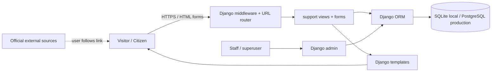

# Architecture

## Overview

CivicLaw is a Django monolith: browser requests enter through `config.urls`, Django middleware provides sessions, CSRF and authentication, and the `support` app handles validated forms, view logic and ORM access. Django Templates render server HTML; local CSS handles responsive presentation. SQLite is the development default and PostgreSQL can be selected with `DATABASE_URL`.

## Modules

- **Core/public pages:** home, about, contact, policies, emergency.
- **Legal information:** categories, published articles, search/filter, source link, pagination, per-user bookmarks.
- **Advocate directory:** public profile and query filtering; admin-managed status; fictional demo entries marked.
- **Complaint guidance:** general steps, official portal link, user-owned checklist state.
- **Citizen services:** directory, search/category, official links.
- **Assistant:** POST form and deterministic keyword retrieval against published article title, summary and body. No LLM/provider is connected.
- **Accounts:** built-in `User`, custom registration/profile forms, Django auth views, saved data and self-delete.
- **Feedback:** stored submissions; private to staff in admin.

## Authentication flow

Django session authentication is used. Registration validates password policy and unique email, saves via Django's password hasher, and logs the citizen in. Protected views use `login_required`. Logout uses Django's CSRF-protected POST endpoint. Password-reset uses Django's time-limited token workflow; local email is printed to the console. Staff access is enforced by Django admin permissions, not hidden frontend controls.

## Search flow

The legal, advocate, guide, and service endpoints constrain input length and use Django ORM `icontains`/`Q` filters. Public content is filtered by publication status. Results are paginated. This is suitable for a demonstrator, not a claim of production-scale search performance.

## Routes

See `support/urls.py`; key routes are `/`, `/legal/`, `/advocates/`, `/complaints/`, `/services/`, `/assistant/`, `/dashboard/`, `/admin/`. Built-in account routes are under `/account/`; Django auth password-change route is included under `/accounts/`.

## Assumptions

No project review guide was found in the workspace at implementation time. India is treated as the sample jurisdiction because the user locale is Hyderabad, but individual content should be checked and reviewed before use. No paid API, SMTP credential, or production host was provided. The app provides no lawyer contact, case filing or official status integrations.
