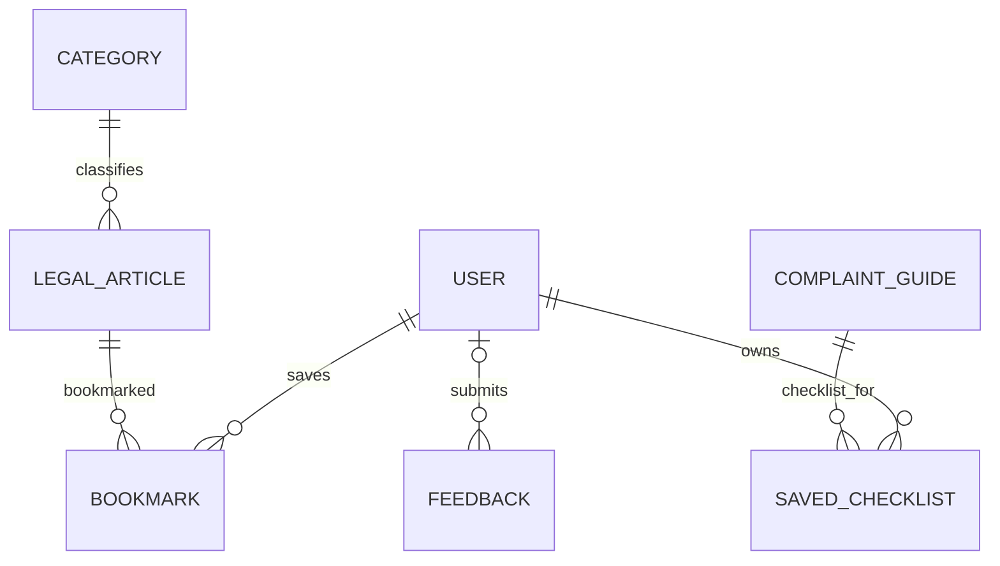

# Database design

Django ORM models are in `support/models.py`; the initial schema is `support/migrations/0001_initial.py`.

- `Category` has a unique name and generated slug.
- `LegalArticle` belongs to a category and includes jurisdiction, language, source title/URL, last-reviewed date and publication status. An index supports published/category lookup.
- `Advocate` contains public profile fields, area/location and administrator-controlled verification status. `demo_record` indicates fictional data.
- `ComplaintGuide` and `CitizenService` contain publication state, jurisdiction and external source/portal links.
- `Bookmark` is unique per user/article and cascades on user or article deletion.
- `SavedChecklist` is unique per user/guide and stores zero-based completed line indexes as JSON; access is filtered by the current user.
- `Feedback` may link to an authenticated user; it uses `SET_NULL` on deletion so its review record remains without that account reference.

The demo uses SQLite. Set `DATABASE_URL=postgresql://...` for PostgreSQL. Run `python manage.py migrate`; do not edit the database directly. `python manage.py seed_demo` uses update-or-create and is repeatable. It does not create credentials.
