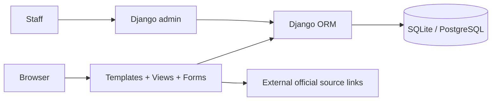
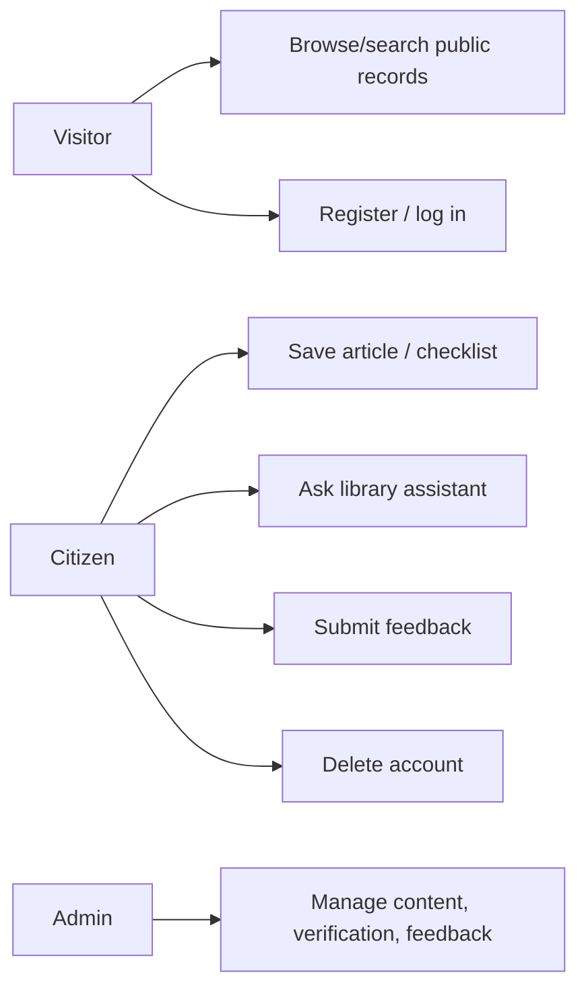
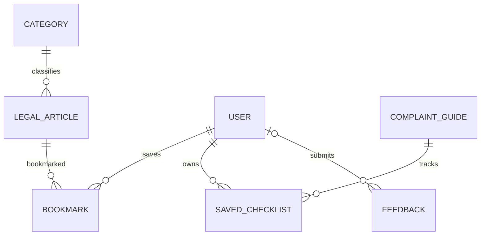

# Project Report — Smart Legal & Citizen Support Platform

## Chapter 1: Introduction

### Background
Legal information and citizen services can be distributed across multiple public sources. A citizen may need to understand a topic, prepare information for a grievance, and locate the official channel. CivicLaw is a responsive web application demonstrating a centralized discovery interface.

### Problem statement
People may find it difficult to discover plain-language explanations and relevant official links in one place. This application addresses discovery and preparation only; it does not establish the scale of the problem through empirical research.

### Objectives
- Provide a searchable public legal-information library with jurisdiction and source metadata.
- Make complaint preparation and public-service discovery easier to navigate.
- Offer a directory search and distinguish platform verification labels.
- Provide personal bookmarks/checklists and safe, role-protected accounts.
- Demonstrate a grounded-by-library assistant without requiring an external model API.

### Scope and motivation
The scope is an academic/local demonstration for India-focused examples, including Hyderabad context. Published content, advocate data, professional review and deployment require ongoing external validation. The system is not legal advice, official filing, advocate appointment, or government case tracking.

## Chapter 2: Existing and proposed system

Information may be found across separate resources, each with its own terminology and process. The proposed system offers a common search and navigation experience with source links and last-review metadata. Benefits include consistent discoverability, saved checklists and clear scope disclaimers. Limitations include dependency on accurate curated content, absence of authority integration, no real advocate profiles in the seed set, and no empirical evidence of user outcomes.

## Chapter 3: Requirement analysis

### Functional requirements implemented
Public home/about/legal library/search/detail, advocate search/detail, complaint guides/checklists, citizen services/detail, emergency links, assistant search, registration/login/logout/password reset/profile/password change/account deletion, dashboard/bookmarks, feedback storage, and Django admin content control.

### Non-functional requirements
Responsive CSS for mobile/tablet/desktop; semantic labels and focus styling; CSRF and Django auth; server-side validation; production environment separation; ORM database access; testable modular project; source/disclaimer visibility.

### Roles
Anonymous visitor, registered citizen and Django staff/superuser. Advocate self-service is not included. Staff-only operations use Django admin permissions.

### Software and hardware
Python 3.11+, Django 5.2, SQLite for local development, PostgreSQL for production, modern browser, and a modest Python web host. Hardware requirements are conventional and have not been benchmarked.

## Chapter 4: System design

### Architecture diagram

### Use-case summary

### Database ER design

### Data flow and authentication
A public or authenticated browser submits an HTTP request. Django middleware establishes session and CSRF handling. The URL selects a view, forms validate user input, ORM queries limit content by publication state and ownership, and templates return escaped HTML. Admin writes pass through Django's authenticated permission system. Assistant questions search approved article data and return matching records; they are not sent to an LLM.

## Chapter 5: Implementation

- **Frontend:** Django templates, shared navigation/footer, bespoke responsive CSS, HTML forms, accessible labels and status notices.
- **Backend/database:** Django 5.2, one `support` app, normalized related models, migrations, SQLite default and PostgreSQL URL parser.
- **Authentication:** built-in User and password hashing; unique email registration; session-based authentication; password reset; protected account data and deletion.
- **Assistant:** deterministic token/substring filtering over published articles, with matched article citations and limitations clearly described.
- **Advocate finder:** searchable records and verification choices; demo profiles explicitly fictional and status admin-controlled.
- **Complaint guidance:** general steps and POST checklist toggles saved by user.
- **Citizen services:** search, category filtering and official URL display.
- **Security:** CSRF, server-side authorization, environment secrets, production secure cookies/HSTS, no confidential chat persistence.

## Chapter 6: Testing

The Django test suite ran with **15 tests passing** in this workspace. It checks published search, draft invisibility, password hashing and registration, duplicate email rejection, login requirement, bookmark persistence and ownership isolation, feedback persistence, assistant retrieval, and checklist ownership. Django reported no system-check issues during that test run. Tests use Django's test client; no Playwright/browser audit, accessibility audit, PostgreSQL test instance, SMTP delivery test, or load test was performed. See `docs/TESTING.md`.

## Chapter 7: Results

Implemented local Django application, database migration, idempotent demo-data command, admin content workflow, account features, public directories, search, saved data and documentation. Test result is the actual 15-test success above. No screenshots, performance results, user counts, live deployment or external integration are claimed. The development server ran in the workspace; HTTP smoke checks returned 200 for home, legal search and CSS. This report records no production deployment.

## Chapter 8: Conclusion and future scope

The project demonstrates a functional information and citizen-support portal with database-backed modules and user-scoped saved records. Future work should prioritize qualified legal review, current source validation, multilingual human-reviewed content, robust login/feedback rate limiting, audit events, accessibility testing, advocate onboarding and independent credential validation, secure email, provider-based deployment verification, search improvements, and user research. No future feature should imply official legal filing or professional endorsement without real integrations and governance.
